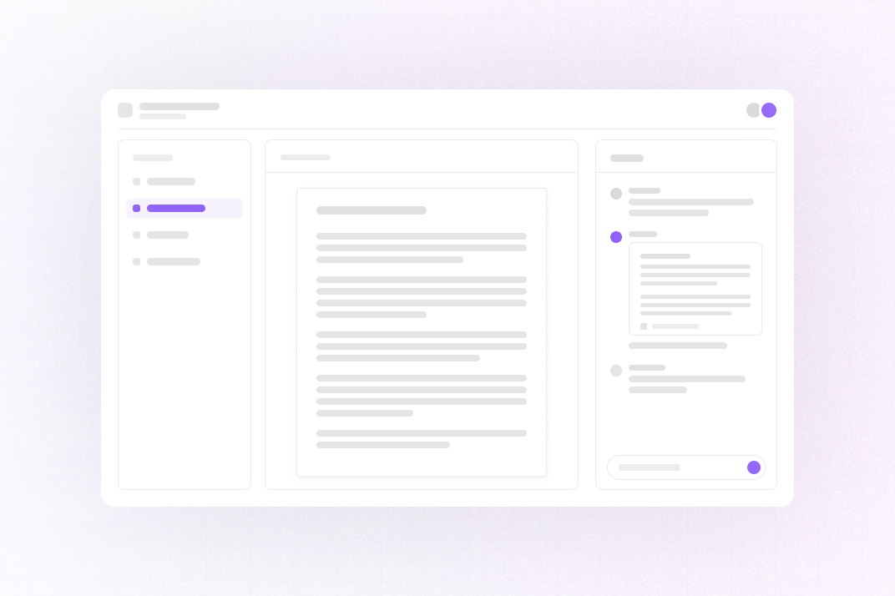

<p align="center">
  <a href="https://liveblocks.io#gh-light-mode-only">
    
  </a>
  <a href="https://liveblocks.io#gh-dark-mode-only">
    
  </a>
</p>

# Language Tutoring

<p>
  <a href="https://liveblocks.io/examples/language-tutoring/nextjs-language-tutoring">
    
  </a>
  <a href="https://codesandbox.io/s/github/liveblocks/liveblocks/tree/main/examples/nextjs-language-tutoring">
    
  </a>
  
  
</p>

This example shows how to build an online language tutoring tool with [Liveblocks](https://liveblocks.io) and
[Next.js](https://nextjs.org/). Tutors and students can read and edit PDFs, documents, and whiteboards together. In the chat you can talk or ask an AI assistant to make changes.



## Getting started

Run the following command to try this example locally:

```bash
npx create-liveblocks-app@latest --example nextjs-language-tutoring --api-key
```

This will download the example and ask permission to open your browser, enabling
you to automatically get your API key from your
[liveblocks.io](https://liveblocks.io) account.

### Manual setup

<details><summary>Read more</summary>

<p></p>

Alternatively, you can set up your project manually:

- Install all dependencies with `npm install`
- Create an account on [liveblocks.io](https://liveblocks.io/dashboard)
- Copy your **secret** key from the
  [dashboard](https://liveblocks.io/dashboard/apikeys)
- Create an `.env.local` file and add your **secret** key as the
  `LIVEBLOCKS_SECRET_KEY` environment variable
- Optionally add `GOOGLE_CLIENT_ID` and `GOOGLE_CLIENT_SECRET` from the
  [Google Cloud console](https://console.cloud.google.com/apis/credentials) to
  enable Google sign-in, with `http://localhost:3000/api/auth/callback/google`
  as an authorized redirect URI. Without them, the sign-in page offers demo
  accounts instead.
- Optionally add an `AI_GATEWAY_API_KEY` from the
  [Vercel AI Gateway](https://vercel.com/docs/ai-gateway) to let the
  `@AI Assistant` in the chat answer and edit documents. Without it, the
  assistant runs in a demo mode with canned edits.
- Run `npm run dev` and go to [http://localhost:3000](http://localhost:3000)

To see realtime sync, sign in as two different users in two browsers (or a
private window), create a room as the first user, and open its invite link as
the second.

</details>

### Dev server setup

<details><summary>Read more</summary>

<p></p>

You can optionally run this example locally using the
[Liveblocks dev server](https://liveblocks.io/docs/tools/dev-server).

- Install the example as detailed above
- Set `LIVEBLOCKS_SECRET_KEY=sk_localdev` in `.env.local`
- Run `npm run dev:local`, which starts the dev server and Next.js together, and
  go to [http://localhost:3000](http://localhost:3000)

</details>

### Deploy on Vercel

<details><summary>Read more</summary>

<p></p>

To both deploy on [Vercel](https://vercel.com), and run the example locally, use
the following command:

```bash
npx create-liveblocks-app@latest --example nextjs-language-tutoring --vercel
```

This will download the example and ask permission to open your browser, enabling
you to deploy to Vercel.

</details>

### Develop on CodeSandbox

<details><summary>Read more</summary>

<p></p>

After forking
[this example](https://codesandbox.io/s/github/liveblocks/liveblocks/tree/main/examples/nextjs-language-tutoring)
on CodeSandbox, create the `LIVEBLOCKS_SECRET_KEY` environment variable as a
[secret](https://codesandbox.io/docs/secrets). Add `GOOGLE_CLIENT_ID` and
`GOOGLE_CLIENT_SECRET` if you want Google sign-in instead of the demo accounts,
and `AI_GATEWAY_API_KEY` to enable the `@AI Assistant`.

</details>

## License

The `tldraw` library is provided under the
[tldraw license](https://github.com/tldraw/tldraw/blob/main/LICENSE.md). To
remove the "Made with tldraw" watermark, you must
[purchase a license](https://tldraw.dev/community/license) and set it as
`NEXT_PUBLIC_TLDRAW_LICENSE_KEY`.
